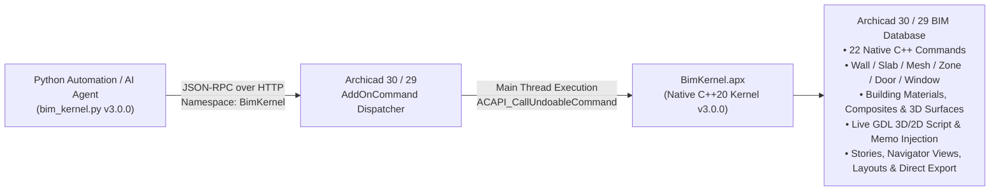

# BimKernel (`BimKernel.apx`) — v3.0.0

[](https://graphisoft.com/downloads/archicad)
[](https://archicadapi.graphisoft.com/)
[](./python/bim_kernel.py)
[](https://github.com/yan-fab/bim-kernel/releases/tag/v3.0.0)
[](./LICENSE.md)

**BimKernel** (`BimKernel.apx`) is a native C++20 Kernel Extension (Add-On) and Python SDK for **Graphisoft Archicad 30 & 29**. It bypasses the limitations of Archicad's built-in Python JSON API by exposing **22 native C++ ACAPI kernel commands** directly under the `"BimKernel"` namespace via `ACAPI_AddOnAddOnCommunication_InstallAddOnCommandHandler`.

---

## What's New in v3.0.0

- **Renamed to `BimKernel` (`BimKernel.apx`):** Clean, universal C++ Add-On identity and `"BimKernel"` JSON-RPC namespace (`bim_kernel.py`).
- **Native Archicad 30 Support (`APIDevKit 30.3000`):** Compiled natively for **Archicad 30** (`BimKernel_AC30.apx` / `BimKernel.apx`) alongside **Archicad 29** (`BimKernel_AC29.apx`), with automatic version detection in `instalar_extensao.bat`.
- **Expanded from 15 to 22 C++ Kernel Commands (+7 New Subsystems):**
  1. `ModifyBuildingMaterials` — List, create, and modify `API_BuildingMaterialID` attributes (`connPriority`, `cutFill`, `cutFillPen`, `cutFillBackgroundPen`, `cutMaterial`).
  2. `ManageComposites` — List, create, and modify multi-skin `API_CompWallID` Composite structures (`API_CWallComponent` skins, thicknesses, core/finish flags, frame pens).
  3. `ManageSurfaces` — List, create, and modify 3D Surface Materials (`API_MaterialID`: RGB color, transparency, shininess, ambient/diffuse/specular reflection).
  4. `ManageStories` — Full building story/level control (`API_StoryInfo` / `API_StoryCmdType`: `list`, `goTo`, `setHeight`, `setElevation`, `rename`, `insAbove`, `insBelow`, `delete`).
  5. `InspectElements` — High-speed C++ batch element telemetry returning 3D bounding boxes (`ACAPI_Element_CalcBounds`), story, layer, Element ID, coordinates, Building Materials, Composites, and opening parameters in a single call.
  6. `ManageNavigatorViews` — List, navigate (`goTo`), and modify Navigator View Map items (`layerCombination`, `modelViewOptName`, `drawingScale`, `penSetName`).
  7. `DirectExport` — Direct headless export of the project or active view to **IFC**, **PDF**, **PLA** (Archive), **PLN**, or **PNG**.
- **Polygonal Element Creation (`Slab`, `Mesh`, `Zone`) & Live GDL 3D/2D Script Injection (`setScript`):**
  - `CreateNativeElements` now builds closed `API_Polygon` + `API_ElementMemo` handles (`memo.coords`, `memo.pends`, `memo.meshPolyZ`) for **Slabs**, **3D Topographic Meshes**, and **Rooms/Zones**.
  - `GetSetGDLParameters` now supports `action="setScript"` via `ACAPI_LibraryPart_UpdateSection` to live-inject 3D and 2D GDL scripts into Library Parts without leaving Archicad.

---

## Architecture



---

## BimKernel v3.0.0 Capabilities (22 Registered C++ Commands)

| # | Kernel Command (`BimKernel.*`) | C++ ACAPI Kernel Primitives | Description |
| :-: | :--- | :--- | :--- |
| **1** | `Ping` | `ACAPI_AddOnIdentification_Application` | Returns kernel health, version (`3.0.0`), Archicad build info, access level (`5`), and all 22 registered commands. |
| **2** | `ChangeElementsLayer` | `ACAPI_Attribute_Create`, `ACAPI_Element_Change` | Moves elements to a target layer (automatically creates the layer if missing). |
| **3** | `ManageHotlinks` | `ACAPI_Hotlink_CreateHotlinkNode`, `ACAPI_Hotlink_BreakHotlinkNode` | Full Hotlink lifecycle: `list`, `import` (`.mod`/`.pln`/`.ifc` with 3D transform), `break` into native elements, and `delete`. |
| **4** | `DeleteElements` | `ACAPI_Element_Delete` | Batch-deletes any elements by GUID in a single undoable transaction. |
| **5** | `ListLayers` | `ACAPI_Attribute_GetNum`, `ACAPI_Attribute_Get` | Lists all project layers with index, name, GUID, `locked`, and `hidden` flags. |
| **6** | `ModifyLayersState` | `ACAPI_Attribute_Modify`, `ACAPI_Attribute_Delete` | Batch lock/unlock, show/hide, or delete layers in the kernel. |
| **7** | `PublishSet` | `ACAPI_Navigator_GetNavigatorSet`, `ACAPI_ProjectOperation_Publish` | Triggers native Archicad Publisher Set export (PDF, DWG, IFC, BIMx). |
| **8** | `ListLayoutDatabases` | `ACAPI_Database_GetLayoutDatabases`, `ACAPI_Window_GetDatabaseInfo` | Enumerates all sheets in the Layout Book with GUID, name, title, and reference ID. |
| **9** | `PlaceDrawingOnLayout` | `ACAPI_Database_ChangeCurrentDatabase`, `ACAPI_Element_Create(API_DrawingID)` | Places single or batch Navigator Views onto Layout Book sheets at exact $(x, y)$ coordinates and scale ratio. |
| **10** | `SetFloorPlanCutPlane` | `ACAPI_ProjectSetting_SetPreferences(APIPrefs_FloorPlanCutPlaneDef)` | Sets global Floor Plan Cut Plane elevation (`currCutLevel`, `topCutLevel`, `bottomCutLevel`). |
| **11** | `SolidElementOperations` | `ACAPI_Element_SolidLink_Create`, `ACAPI_Element_SolidLink_Remove` | Native Boolean SEO (`substract`, `substract_upward`, `substract_downward`, `intersect`, `add`) between target and operator GUIDs. |
| **12** | `ModifyElementsGeometry` | `ACAPI_Element_Edit`, `ACAPI_Element_Change`, `ACAPI_Element_ChangeElementInfoString` | Batch 3D transform (`drag`, `elevate`, `rotate`) or direct modification of coordinates, heights, thicknesses, materials, composites, ratios, and opening dimensions. |
| **13** | `CreateNativeElements` | `ACAPI_Element_GetDefaults`, `ACAPI_Element_Create` | Batch creation of native `Wall`, `Column`, `Beam`, `Door`, `Window`, `Object`, `Slab`, `Mesh`, and `Zone` elements. |
| **14** | `GetSetGDLParameters` | `ACAPI_Element_GetMemo`, `ACAPI_Element_ChangeMemo`, `ACAPI_LibraryPart_UpdateSection` | Reads/modifies GDL parameters (`API_AddParType`) and live-injects 3D/2D GDL scripts (`action="setScript"`). |
| **15** | `DatabaseAndViewControl` | `ACAPI_View_Rebuild`, `ACAPI_View_Redraw`, `ACAPI_ProjectOperation_Save` | Forces 3D/2D model rebuild & regeneration, viewport redraw, or `.pln` project save/saveAs. |
| **16** | `ModifyBuildingMaterials` | `ACAPI_Attribute_Search`, `ACAPI_Attribute_Modify`, `ACAPI_Attribute_Create` | Lists, creates, or modifies `API_BuildingMaterialID` (`connPriority`, `cutFill`, `cutFillPen`, `cutFillBackgroundPen`, `cutMaterial`). |
| **17** | `ManageComposites` | `ACAPI_Attribute_GetDefExt`, `ACAPI_Attribute_CreateExt`, `ACAPI_Attribute_ModifyExt` | Lists, creates, or modifies multi-skin `API_CompWallID` Composite structures (`API_CWallComponent`). |
| **18** | `ManageSurfaces` | `ACAPI_Attribute_Get`, `ACAPI_Attribute_Create`, `ACAPI_Attribute_Modify` | Lists, creates, or modifies `API_MaterialID` 3D Surface Materials (RGB, transparency, shininess, reflection). |
| **19** | `ManageStories` | `ACAPI_ProjectSetting_GetStorySettings`, `ACAPI_ProjectSetting_ChangeStorySettings` | Lists, creates (`insAbove`/`insBelow`), renames, deletes, or adjusts heights and elevations of building stories. |
| **20** | `InspectElements` | `ACAPI_Element_GetElemList`, `ACAPI_Element_Get`, `ACAPI_Element_CalcBounds` | Fast kernel batch telemetry returning 3D bounding boxes (`xMin..zMax`), story, layer, ID, materials, composites, and coordinates. |
| **21** | `ManageNavigatorViews` | `ACAPI_Navigator_GetNavigatorChildrenItems`, `ACAPI_Navigator_ChangeNavigatorView`, `ACAPI_View_GoToView` | Lists View Map items, activates views (`goTo`), and modifies Layer Combination, Model View Options, and Scale. |
| **22** | `DirectExport` | `ACAPI_ProjectOperation_Save`, `ACAPI_IFC_GetIFCExportTranslatorsList` | Direct export of the project or active view to `ifc`, `pdf`, `pla`, `pln`, or `png`. |

---

## Quick Start & Installation

### Option 1: Install Pre-Compiled Binary (Recommended)
1. Download `BimKernel_AC30.apx` (for **Archicad 30**), `BimKernel_AC29.apx` (for **Archicad 29**), and `instalar_extensao.bat` from the [**Latest Release (v3.0.0)**](https://github.com/yan-fab/bim-kernel/releases/tag/v3.0.0).
2. Run `instalar_extensao.bat` (automatically requests Administrator privileges and installs into `C:\Program Files\Graphisoft\Archicad 30\Add-Ons\Extras\` and/or `Archicad 29\Add-Ons\Extras\`).
3. Restart **Archicad 30** (or load `BimKernel.apx` via **Options > Add-On Manager**).

### Option 2: Build from Source (Archicad 30 & 29)
Requires **Visual Studio 2022 (MSVC v143, x64)**, **CMake 3.19+**, and **Python 3.10+**:

```powershell
python Tools/BuildAddOn.py -c config.json -v 30 29 -b Release
```

---

## Python SDK Usage Examples (`bim_kernel.py`)

```python
import bim_kernel as bk

# 1. Verify BimKernel v3.0.0 connection & list all 22 commands
print(bk.ping())

# 2. Fast batch inspection with 3D bounding boxes, stories, layers, and materials
walls = bk.inspect_elements(types=["Wall", "Window", "Door"], floor_ind=0)

# 3. Create or modify Building Materials, 3D Surfaces, and multi-skin Composites
bk.modify_building_materials([{
    "material": "Madeira - CLT Painel Estrutural",
    "connPriority": 820,
    "cutFill": "Plywood",
    "cutFillPen": 1,
    "cutFillBackgroundPen": 0,
    "createIfMissing": True
}])

bk.create_or_modify_composite(
    name="PAREDE DRYWALL ACUSTICA 14CM",
    skins=[
        {"buildingMaterial": "Gesso Cartonado", "thickness": 0.025, "framePen": 1, "isFinish": True},
        {"buildingMaterial": "Isolamento Fibra Mineral", "thickness": 0.090, "framePen": 1, "isCore": True},
        {"buildingMaterial": "Gesso Cartonado", "thickness": 0.025, "framePen": 1, "isFinish": True},
    ]
)

# 4. Create polygonal Slabs, Meshes, and Zones natively
bk.create_native_elements([{
    "type": "Slab",
    "floorInd": 0,
    "level": 0.0,
    "thickness": 0.20,
    "buildingMaterial": "Betão Estrutural",
    "layerName": "EST_LAJES",
    "elemId": "LAJE-TERREO-01",
    "polygon": [
        {"x": 0.0, "y": 0.0},
        {"x": 12.0, "y": 0.0},
        {"x": 12.0, "y": 8.0},
        {"x": 0.0, "y": 8.0}
    ]
}])

# 5. Direct export to IFC / PDF / PLA
bk.direct_export(r"C:\Exports\PROJETO_EXECUTIVO_LOD400.ifc", format="ifc")
```

---

## Links & Resources

- **Repository:** [https://github.com/yan-fab/bim-kernel](https://github.com/yan-fab/bim-kernel)
- **Releases & Binary Assets (`.apx`):** [https://github.com/yan-fab/bim-kernel/releases](https://github.com/yan-fab/bim-kernel/releases)
- **Graphisoft Archicad API DevKit:** [https://archicadapi.graphisoft.com/](https://archicadapi.graphisoft.com/)

## License

Released under the [MIT License](./LICENSE.md). Copyright (c) 2026 BimKernel / Yan.
